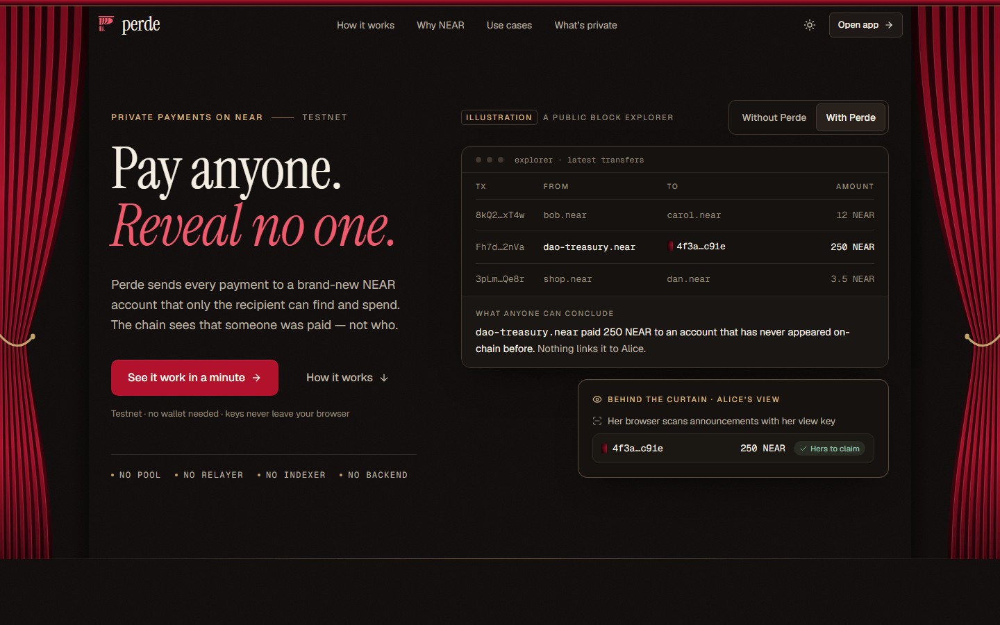
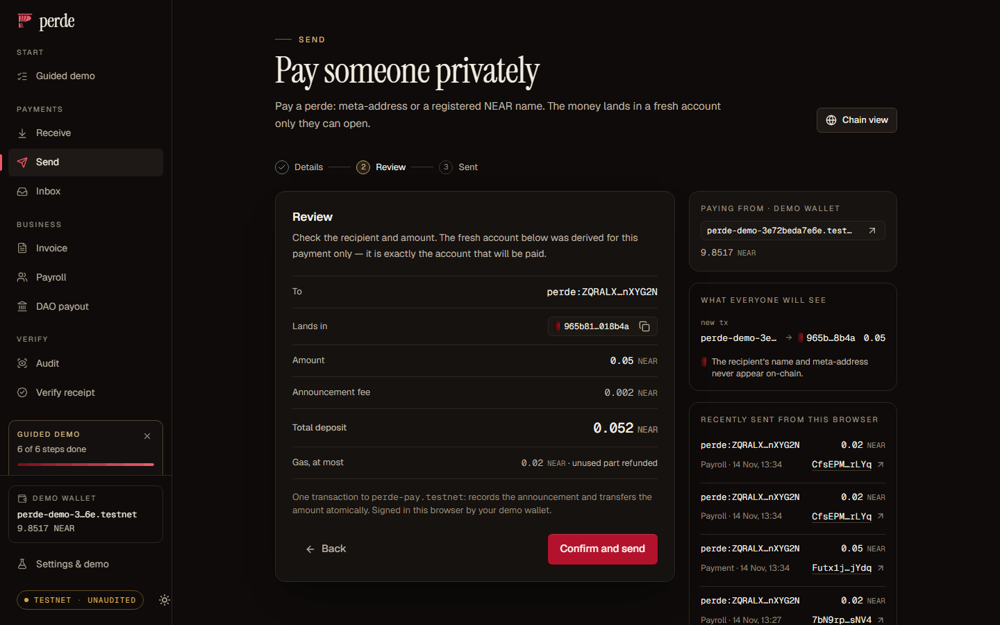
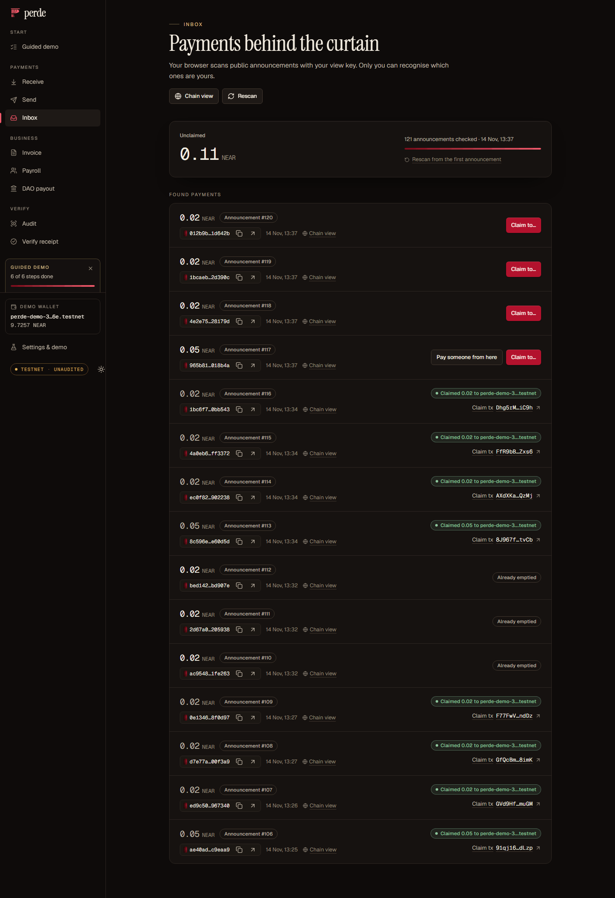
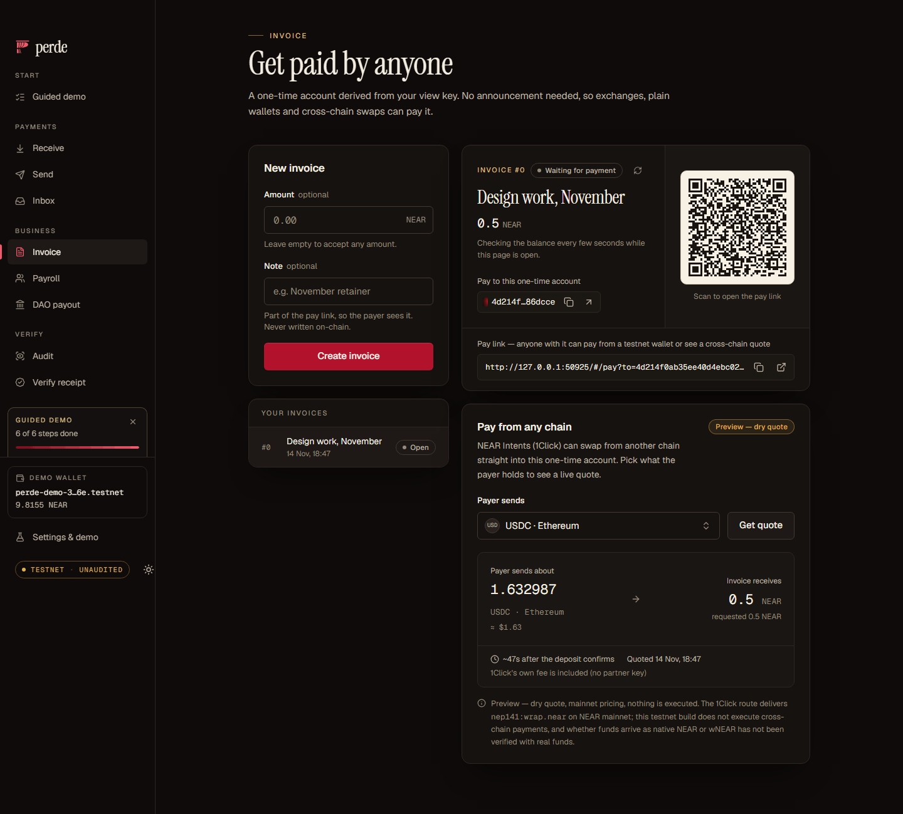
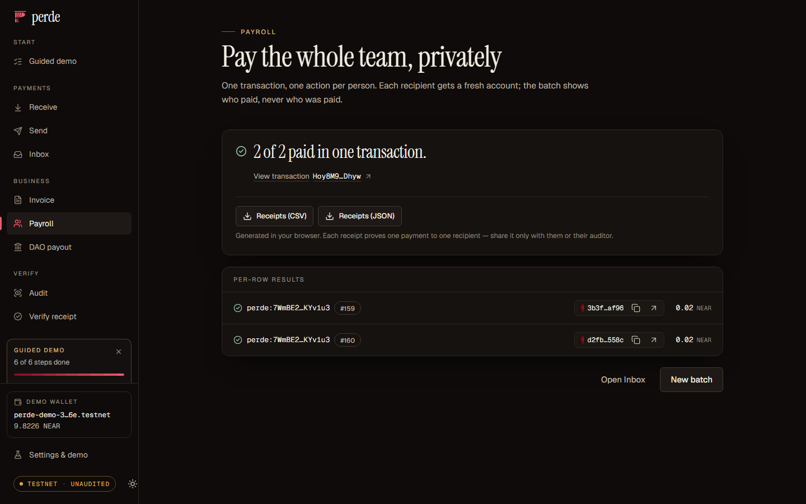

# Perde — private payments on NEAR

*Perde* is Turkish for "curtain".

**Problem.** Every payment on NEAR names its recipient. When a DAO pays a contributor, a company runs payroll or a freelancer gets an invoice paid, anyone can read who was paid, how much, and everything else that account holds.

**Product.** Perde lets you publish one **meta-address** (or register it under your NEAR name). Every payment to it lands in a brand-new **stealth account** that only you can find and spend. The chain shows that someone was paid. It does not show who.

**How NEAR fits in.** A NEAR implicit account id is an ed25519 public key written as 64 hex characters, and a transfer to it creates the account. So a stealth public key *is* a NEAR account:

| Usually needed for stealth payments | On NEAR |
| --- | --- |
| A pool contract that holds everyone's funds | Not needed. Funds sit in the recipient's own implicit account. |
| A relayer to pay gas for the recipient | Not needed. The stealth account pays its own gas. |
| An indexer to find payments | Not needed. Announcements are read with contract view calls over public RPC. |
| A backend | Not needed. The app is a static site; keys stay in the browser. |

On top of that primitive, Perde uses NEAR named accounts (pay `alice.testnet` privately), batched actions (payroll in one transaction), SputnikDAO (a treasury pays a contributor without naming them) and NEAR Intents 1Click (quote a payment from another chain into a stealth account).

Status: research prototype, unaudited, **NEAR testnet only**. Built at NEAR HACKATHON (2026-11-01 to 2026-11-14). Tracks: `privacy`, `realworld`, `social`, `open`.



## Try it

Requirements: Node.js 22 or newer and npm. No wallet, no API key, no funds, no `.env`.

### 1. One command, in the terminal (about 25 seconds)

```bash
npm run demo:testnet
```

You see nine numbered steps run against NEAR testnet, each with explorer links, ending in a summary table and `all required steps passed`:

| Step | What happens | What you see |
| --- | --- | --- |
| 0 | A funded testnet account is created through the public faucet (cached in `.cache/` for later runs) | account id and balance |
| 1 | Bob creates keys | his `perde:…` meta-address |
| 2 | Alice sends 0.1 NEAR to the meta-address through the contract | transaction link |
| 3 | The public announcement is printed next to Bob's scan result; a third party's scan finds nothing | `Eve … found 0` |
| 4 | Bob claims with the derived stealth key | transaction signed by a 64-hex account |
| 5 | Invoice mode: a one-time account is paid with a plain transfer and found without any announcement | two transaction links |
| 6 | A real NEAR Intents 1Click **dry** quote: pay the invoice with USDC from Arbitrum | `DRY-RUN PREVIEW`, amount and ETA |
| 7 | A payment receipt verifies; a forged one is rejected | `valid true` / `valid false` |
| 8 | A SputnikDAO proposal pays a contributor privately, an outsider approves, the recipient finds and claims it | proposal id, two transaction links |

A recorded run is in [`evidence/demo-testnet-run.md`](evidence/demo-testnet-run.md). `npm run -s demo:testnet -- --json` prints a machine-readable result. The exit code is 0 only if every required step passed.

If the faucet refuses (it allows about 10 new accounts per IP per 12 hours), the script says so and exits with code 2; set `DEMO_ACCOUNT_ID` and `DEMO_PRIVATE_KEY` to any funded testnet account instead.

### 2. The web app

```bash
npm run setup     # installs packages/core and apps/web, builds the core library
npm run dev       # http://localhost:5173
```

1. Open `http://localhost:5173` — you see the landing page. Toggle **Without Perde / With Perde** to see the same payment as a block explorer shows it, before and after.
2. Click **Try the live demo** — you see the guided demo checklist.
3. Click **Run steps 1–4** — the app creates a testnet wallet from the faucet, creates your identity, sends 0.05 NEAR to your own meta-address and scans for it. The checklist ticks itself off from real chain state; each step shows a transaction link.
4. Open **Inbox** — you see the 0.05 NEAR payment and the stealth account that holds it.
5. Click **Chain view** — you see what a public observer gets (the transaction, the contract call, the announcement row) next to what only you know.
6. Click **Claim to…**, keep the suggested destination, confirm — you see the claim transaction, signed in the browser by the stealth account itself. (Or click **Pay someone from here** to pay another meta-address straight from the stealth account, without ever claiming.)
7. Open **Invoice**, create an invoice for 0.5 NEAR, pick *USDC · Ethereum* under **Pay from any chain** and click **Get quote** — you see a real 1Click quote labelled *Preview — dry quote*.
8. Open **Payroll**, click **Load sample**, review and send — you see one transaction containing several private payments.
9. Open **DAO payout**, click **Propose payout**, then **Approve & execute** — you see the public proposal (which contains no recipient) and, back in the Inbox, the payout.
10. Open **Audit** and paste your viewing key (from **Receive**) — you see a read-only list of incoming payments.

If the faucet is rate-limited, use **Settings & demo → Use an existing testnet account**.

### 3. Tests

```bash
npm test                # 156 offline tests: protocol, transaction encoding, RPC, DAO, UI logic
npm run lint
npm run typecheck
npm run build
npm run test:contract   # 36 Rust unit tests (needs rustup; the pinned toolchain installs itself)
npm run test:testnet    # live NEAR testnet integration tests (uses the faucet once, then a cached account)
```

## Demo video and screenshots

A 2:54 recording of the web app doing real testnet transactions: [`demo/demo.mp4`](demo/demo.mp4) ([`demo/demo.webm`](demo/demo.webm)). It follows [`DEMO.md`](DEMO.md) step by step; regenerate it with `npm run demo:video`.

| | |
| --- | --- |
|  Guided demo: every tick comes from real chain state |  Send: the fresh stealth account is shown before signing |
|  Inbox: payments found with the view key |  Chain view: what the public sees next to what you know |
|  A SputnikDAO proposal that never names the recipient |  Invoice with a live NEAR Intents dry quote |
|  Payroll: several private payments in one transaction |  Audit: read-only access with a viewing key |

 

## What is implemented

Every row is something you can run. Nothing here is mocked; the only preview-only feature is marked as such.

| Feature | Code | Test or evidence |
| --- | --- | --- |
| Stealth address derivation, scanning with view tags, spend-key recovery | `packages/core/src/crypto/stealth.ts` | `packages/core/test/crypto.test.ts` |
| A scalar-derived key controls a NEAR implicit account (scalar EdDSA signer) | `packages/core/src/near/signer.ts` | `crypto.test.ts`, `near.test.ts`; live: [`evidence/core-testnet-run.md`](evidence/core-testnet-run.md) §1 |
| Announcement contract: atomic announce + transfer, name directory | `contracts/perde/src/lib.rs` | `contracts/perde/src/tests.rs`; live: [`evidence/contract-testnet-smoke.md`](evidence/contract-testnet-smoke.md) |
| Send, scan, claim | `packages/core/src/perde/client.ts`, `apps/web/src/features/{send,inbox}` | `perde.test.ts`; `core-testnet-run.md` §3 |
| Pay onward: a stealth account pays another meta-address itself, so funds never touch a named account | `apps/web/src/features/inbox/onward.ts`, `OnwardDialog.tsx` | `onward.test.ts`; `apps/web/scripts/e2e-smoke.mjs` |
| Pay a registered NEAR name privately | `register` / `get_meta_address` in the contract | `core-testnet-run.md` §3 |
| Invoices without announcements | `deriveInvoice`, `scanInvoices` | `crypto.test.ts`; `core-testnet-run.md` §2 |
| Payroll: many payments in one transaction | `sendBatch`, `apps/web/src/features/payroll` | `batch.test.ts`, `csv.test.ts`; `core-testnet-run.md` §3 |
| DAO treasury pays privately through SputnikDAO | `packages/core/src/dao/`, `apps/web/src/features/dao` | `dao.test.ts`; live: [`evidence/dao-private-payment.md`](evidence/dao-private-payment.md) |
| Viewing key (read-only audit) | `encodeViewingKey`, `apps/web/src/features/audit` | `crypto.test.ts` |
| Payment receipts | `packages/core/src/crypto/receipt.ts`, `apps/web/src/features/verify` | `crypto.test.ts`, demo step 7 |
| Cross-chain quote into a stealth account (NEAR Intents 1Click) — **dry quotes only** | `packages/core/src/oneclick.ts`, `apps/web/src/features/anychain` | `services.test.ts`; [`evidence/oneclick-dry-quote.json`](evidence/oneclick-dry-quote.json) |

Live deployment (NEAR testnet), from [`deployments/testnet.json`](deployments/testnet.json):

- Contract: [`perde-pay.testnet`](https://testnet.nearblocks.io/address/perde-pay.testnet)
- Demo DAO: [`perde-demo.sputnikv2.testnet`](https://testnet.nearblocks.io/address/perde-demo.sputnikv2.testnet), created through the official `sputnikv2.testnet` factory

## How it works

```
 Recipient (browser)                 Sender (browser, DAO or script)          NEAR testnet
 ───────────────────                 ───────────────────────────────          ────────────
 12 words → k_spend, k_view
 meta-address = K_spend ‖ K_view ──► r random, R = r·G
                                     P = K_spend + H(r·K_view)·G
                                     send(hex(P), R, view_tag) + amount ───►  perde-pay.testnet
                                                                              ├─ stores {hex(P), R, tag, amount}
                                                                              └─ Transfer → account hex(P) (created)
 get_announcements (view call) ◄──────────────────────────────────────────────┘
 for each: k_view·R → same P?  → "mine"
 p = k_spend + H(k_view·R)
 sign with p as account hex(P) ──────────────────────────────────────────────► Transfer / DeleteAccount → destination
```

```
apps/web/         Vite + React + TypeScript static SPA (no backend)
packages/core/    @perde/core: protocol, NEAR transactions and RPC, contract / DAO / 1Click clients
contracts/perde/  Rust contract (near-sdk): announcements + name directory
scripts/          terminal demo, contract deploy, DAO setup
evidence/         recorded real runs with transaction links
deployments/      live contract and DAO ids
docs/             protocol + threat model, research notes
```

The protocol and the threat model are in [`docs/PROTOCOL.md`](docs/PROTOCOL.md).

## What is and is not private

| Hidden from a public observer | Public |
| --- | --- |
| Which meta-address or NEAR name was paid | The paying account |
| That two payments went to the same recipient | The amount and the time |
| The recipient's other accounts and balances | That Perde was used, and where claimed funds go |

Perde hides the recipient, not the flow of funds. It is weaker than shielded pools or confidential transfers, which also hide amounts. Claiming a payment to your named account links the two; the app warns before you do it, and offers to pay onward from the stealth account instead.

## Limitations

- Unaudited. Scalar arithmetic in JavaScript is not constant-time. Do not use with funds you care about.
- Testnet only. The contract's deployer still holds a full-access key on `perde-pay.testnet` and could redeploy it. The contract never holds funds between calls, so funds already in stealth accounts are out of its reach.
- The web app stores keys unencrypted in `localStorage`.
- NEAR Intents has no testnet. Cross-chain quotes are real 1Click **dry** quotes at mainnet prices; this project has not executed a cross-chain payment. The route delivers `nep141:wrap.near`; whether an implicit account receives native NEAR or wNEAR is unverified, and Perde cannot yet sweep fungible tokens.
- Only NEAR itself is supported, not NEP-141 tokens.
- A viewing key cannot be revoked; create a new identity instead.
- The demo DAO lets anyone approve proposals. It exists to demonstrate the flow; a real DAO keeps its own policy.
- Scanning reads every announcement, so it slows down linearly as the contract is used.
- The contract is built with plain `cargo` and `wasm-opt`, not a reproducible `cargo near` build (see [`contracts/perde/README.md`](contracts/perde/README.md)).
- The live tests and demos depend on public testnet RPC endpoints and the public faucet, which are rate-limited.

## Built with

- **NEAR**: implicit accounts, named accounts, batched actions, NEP-297 events, `near-sdk` 5 (Rust), JSON-RPC via FastNEAR and dRPC public endpoints, the testnet faucet helper, SputnikDAO v2 (`sputnikv2.testnet`), NEAR Intents 1Click API.
- **Libraries**: `@noble/curves`, `@noble/hashes`, `@scure/bip39`, `@scure/base` (cryptography); React 19, Vite, Tailwind CSS 4, `react-router`, `motion`, `lucide-react`, `qrcode.react`, Fontsource fonts (Instrument Serif, Geist, Geist Mono); Vitest, Testing Library, Playwright, ESLint, TypeScript; `near-api-js` (tests and scripts only); `binaryen` (`wasm-opt`).
- **AI assistance**: the code, tests and documentation in this repository were written with Claude Code (an AI coding agent) during the hackathon window, under the author's direction.

Everything in this repository was created inside the hackathon window; there is no earlier baseline.

## Deploying the static site

`npm run build` writes `apps/web/dist/`. It uses relative asset paths and hash routing, so any static host works. On Vercel: import the repository, set the build command to `npm run setup && npm run build` and the output directory to `apps/web/dist`.

## License

Apache-2.0. See [`LICENSE`](LICENSE).
