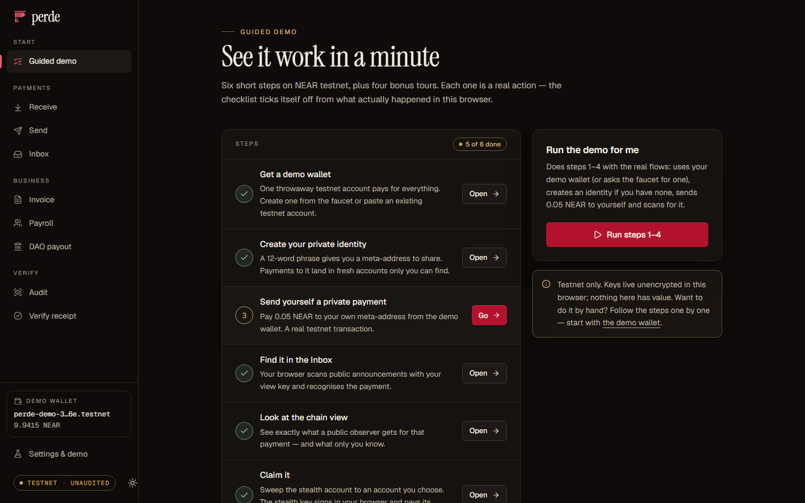
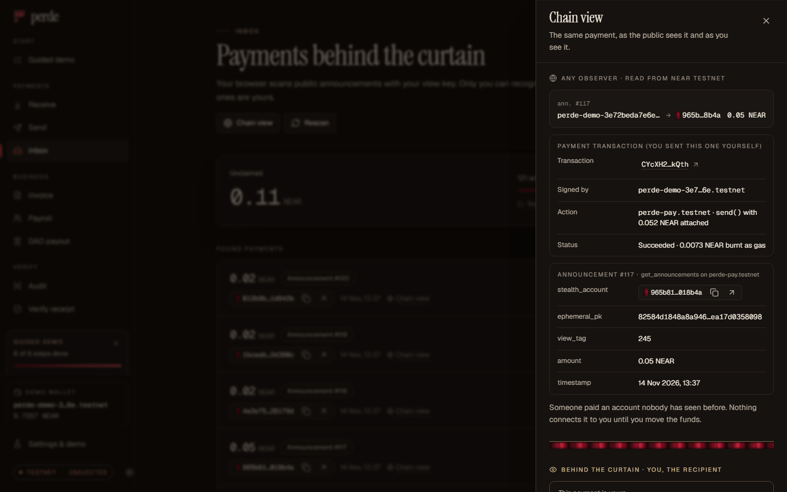
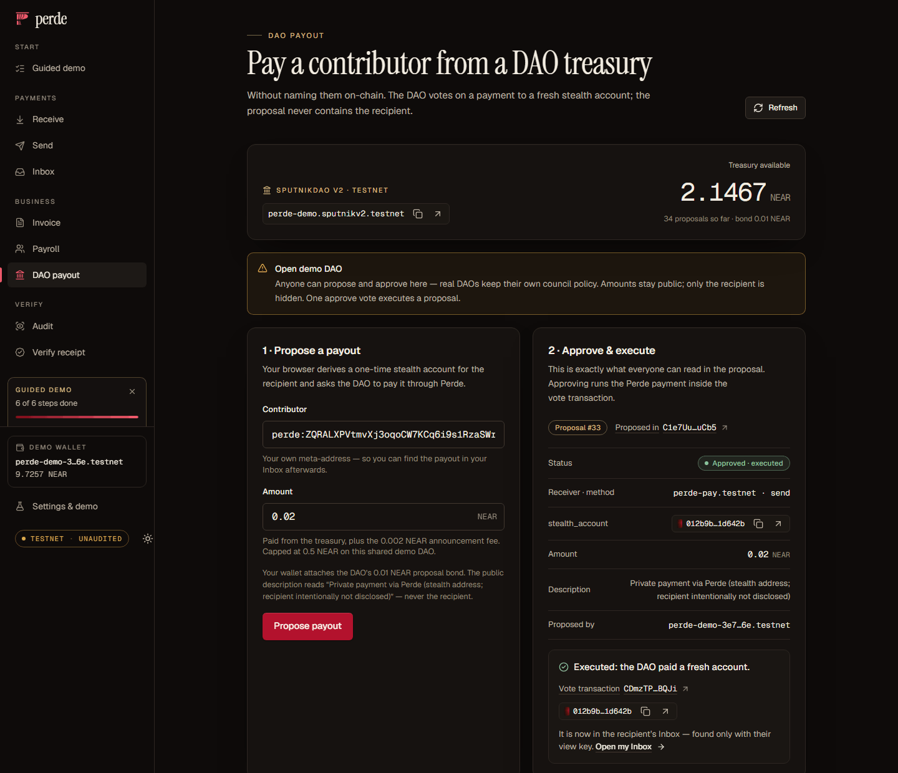
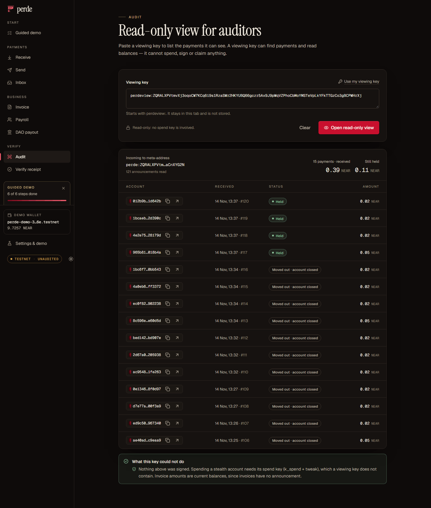
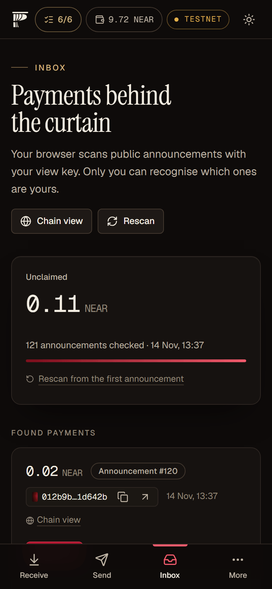
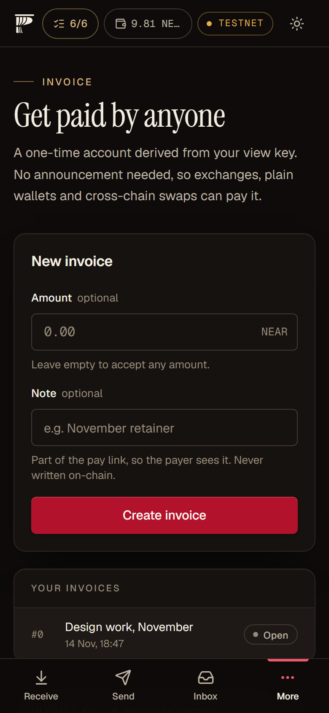

# Perde — private payments on NEAR

*Perde* is Turkish for "curtain".

**Live demo:** https://YOUR-VERCEL-URL  ·  **Demo post:** https://x.com/YOUR-POST  ·  **Video:** [`demo/demo.mp4`](demo/demo.mp4)

**Problem.** Every payment on NEAR names its recipient. When a DAO pays a contributor, a team runs payroll or a freelancer gets an invoice paid, anyone can read who was paid, how much, and everything else that account holds.

**Product.** With Perde you publish one **meta-address**, or register it under your NEAR name. Every payment to it lands in a brand-new **stealth account** that only you can find and spend. The chain shows that someone was paid. It does not show who.

**How NEAR fits in.** A NEAR implicit account id is an ed25519 public key written as 64 hex characters, and a transfer to it creates the account. So a stealth public key *is* a NEAR account:

| Usually needed for stealth payments | On NEAR |
| --- | --- |
| A pool contract that holds everyone's funds | Not needed. Funds sit in the recipient's own implicit account. |
| A relayer to pay gas for the recipient | Not needed. The stealth account pays its own gas. |
| An indexer to find payments | Not needed. Announcements are read with contract view calls over public RPC. |
| A backend | Not needed. The app is a static site; keys stay in the browser. |

On top of that primitive Perde uses NEAR named accounts (pay `alice.testnet` privately), batched actions (payroll in one transaction), SputnikDAO (a treasury pays a contributor without naming them) and NEAR Intents 1Click (quote a payment from another chain into a stealth account).

Status: research prototype, unaudited, **NEAR testnet only**. Built at NEAR HACKATHON (2026-11-01 to 2026-11-14). Tracks: `privacy`, `social`, `realworld`, `open`.


## Try it (live, in the browser)

No wallet, no install, no funds. The app creates a throwaway testnet account for you. Every step below is a real NEAR testnet transaction.

1. Open the live demo. On the landing page, toggle **Without Perde / With Perde** — you see the same payment as a block explorer shows it, before and after.
2. Click **See it work in a minute** — you see the guided demo checklist.
3. Click **Run steps 1–4** — the app creates a testnet wallet from the public faucet, creates your identity, sends 0.05 NEAR to your own meta-address and scans for it. Each tick comes from chain state and carries a transaction link.
4. Open **Inbox** — you see the 0.05 NEAR payment and the 64-hex stealth account that holds it.
5. Click **Chain view** on that payment — you see what any observer can read (the transaction, the contract call, the announcement) next to what only you know.
6. Click **Pay someone from here**, choose **My own address**, send 0.02 NEAR — the stealth account signs the payment itself; your wallet is not involved, and a second payment appears in the Inbox.
7. Click **Claim to…** on a payment and enter a destination — you see the claim transaction, signed in the browser by the stealth account.
8. Open **DAO payout**, click **Propose payout**, then **Approve & execute** — you see the public SputnikDAO proposal, which contains no recipient, and the payout arrives in your Inbox.
9. Open **Invoice**, create an invoice for 0.5 NEAR, pick *USDC · Ethereum* under **Pay from any chain**, click **Get quote** — you see a live NEAR Intents 1Click quote, labelled *Preview — dry quote*.
10. Open **Payroll**, click **Load sample**, review and send — you see one transaction that contains several private payments.
11. Open **Audit** and paste your viewing key (from **Receive**) — you see a read-only list of incoming payments.

The public testnet faucet allows about ten new accounts per IP address in twelve hours. If it refuses, the app says so; use **Settings & demo → Use an existing testnet account** with any funded testnet account.

## Video and screenshots

[`demo/demo.mp4`](demo/demo.mp4) ([`demo/demo.webm`](demo/demo.webm)) is a screen recording of the app on testnet. Nothing in it is simulated.

| | |
| --- | --- |
|  Guided demo: every tick comes from chain state |  Send: the fresh stealth account is shown before signing |
|  Inbox: payments found with the view key |  Chain view: what the public sees next to what you know |
|  A SputnikDAO proposal that never names the recipient |  Invoice with a live NEAR Intents dry quote |
|  Payroll: several private payments in one transaction |  Audit: read-only access with a viewing key |

 

## What is implemented

Every row can be checked. Nothing is mocked; the one preview-only feature is marked.

| Feature | Code | Test or evidence |
| --- | --- | --- |
| Stealth address derivation, scanning with view tags, spend-key recovery | `packages/core/src/crypto/stealth.ts` | `packages/core/test/crypto.test.ts` |
| A scalar-derived key controls a NEAR implicit account (scalar EdDSA signer) | `packages/core/src/near/signer.ts` | `crypto.test.ts`, `near.test.ts`; live: [`evidence/core-testnet-run.md`](evidence/core-testnet-run.md) §1 |
| Announcement contract: atomic announce + transfer, name directory | `contracts/perde/src/lib.rs` | `contracts/perde/src/tests.rs`; live: [`evidence/contract-testnet-smoke.md`](evidence/contract-testnet-smoke.md) |
| Send, scan, claim | `packages/core/src/perde/client.ts`, `apps/web/src/features/{send,inbox}` | `perde.test.ts`; `core-testnet-run.md` §3 |
| Pay onward: a stealth account pays another meta-address itself, so funds never touch a named account | `apps/web/src/features/inbox/onward.ts` | `onward.test.ts`; `e2e/tests/testnet/money-path.spec.ts` |
| Pay a registered NEAR name privately | `register` / `get_meta_address` in the contract | `core-testnet-run.md` §3 |
| Invoices without announcements | `deriveInvoice`, `scanInvoices` | `crypto.test.ts`; `core-testnet-run.md` §2 |
| Payroll: many payments in one transaction | `sendBatch`, `apps/web/src/features/payroll` | `batch.test.ts`, `csv.test.ts`; `core-testnet-run.md` §3 |
| DAO treasury pays privately through SputnikDAO | `packages/core/src/dao/`, `apps/web/src/features/dao` | `dao.test.ts`; live: [`evidence/dao-private-payment.md`](evidence/dao-private-payment.md) |
| Viewing key (read-only audit) | `encodeViewingKey`, `apps/web/src/features/audit` | `crypto.test.ts` |
| Payment receipts, checked against the announcement and the transaction | `packages/core/src/crypto/receipt.ts`, `packages/core/src/perde/receipt-tx.ts` | `crypto.test.ts`, `receipt-tx.test.ts` |
| Cross-chain quote into a stealth account (NEAR Intents 1Click) — **dry quotes only** | `packages/core/src/oneclick.ts`, `apps/web/src/features/anychain` | `services.test.ts`; [`evidence/oneclick-dry-quote.json`](evidence/oneclick-dry-quote.json) |

Live deployment on NEAR testnet, from [`deployments/testnet.json`](deployments/testnet.json):

- Contract: [`perde-pay.testnet`](https://testnet.nearblocks.io/address/perde-pay.testnet)
- Demo DAO: [`perde-demo.sputnikv2.testnet`](https://testnet.nearblocks.io/address/perde-demo.sputnikv2.testnet), created through the official `sputnikv2.testnet` factory

## How it works

```
 Recipient (browser)                 Sender (browser, DAO or script)          NEAR testnet
 ───────────────────                 ───────────────────────────────          ────────────
 12 words → k_spend, k_view
 meta-address = K_spend ‖ K_view ──► r random, R = r·G
                                     P = K_spend + H(r·K_view)·G
                                     send(hex(P), R, view_tag) + amount ───►  perde-pay.testnet
                                                                              ├─ stores {hex(P), R, tag, amount}
                                                                              └─ Transfer → account hex(P) (created)
 get_announcements (view call) ◄──────────────────────────────────────────────┘
 for each: k_view·R → same P?  → "mine"
 p = k_spend + H(k_view·R)
 sign with p as account hex(P) ──────────────────────────────────────────────► pay onward, or Transfer / DeleteAccount → destination
```

```
apps/web/         Vite + React + TypeScript static site (no backend)
packages/core/    @perde/core: protocol, NEAR transactions and RPC, contract / DAO / 1Click clients
contracts/perde/  Rust contract (near-sdk): announcements + name directory
e2e/              Playwright browser tests
scripts/          terminal demo, contract deploy, DAO setup, video recorder
evidence/         recorded real runs with transaction links
deployments/      live contract and DAO ids
docs/             protocol + threat model, QA report, screenshots
```

The protocol and the threat model are in [`docs/PROTOCOL.md`](docs/PROTOCOL.md).

## What is and is not private

| Hidden from a public observer | Public |
| --- | --- |
| Which meta-address or NEAR name was paid | The paying account |
| That two payments went to the same recipient | The amount and the time |
| The recipient's other accounts and balances | That Perde was used, and where claimed funds go |

Perde hides the recipient, not the flow of funds. Claiming a payment to your named account links the two; the app warns before you do it and offers to pay onward from the stealth account instead.

## How it compares

NEAR already has stronger privacy products: confidential payments in NEAR Intents and the NEAR Business confidential treasury hide amounts and balances as well, by keeping that state inside their own infrastructure. Stealth addresses themselves are a known technique (Monero, ERC-5564 on Ethereum).

Perde is the minimal end of that range. It hides less, and asks for less:

- Nothing to trust beyond NEAR itself: no enclave, no operator, no pool. A stealth account is a plain NEAR account.
- Anyone can pay one. An invoice address is an ordinary account id, so a wallet, an exchange withdrawal, a DAO proposal or a cross-chain swap can pay it without knowing Perde exists.
- It needs no infrastructure: one small contract and a static page.

## Limitations

- Unaudited. Scalar arithmetic in JavaScript is not constant-time. Do not use with funds you care about.
- Testnet only. The contract has no owner or admin methods, but the deployer still holds a full-access key on `perde-pay.testnet` and could redeploy it. The contract never holds funds between calls, so funds already in stealth accounts are out of its reach.
- Privacy depends on how many others use it. Today the announcements on the contract are almost all from our own tests, so the anonymity set is effectively empty.
- Cost: each private payment creates a new account. On testnet a send costs about 0.007 NEAR in gas plus a 0.002 NEAR announcement fee, with a 0.01 NEAR minimum amount. A plain transfer costs about 0.00005 NEAR.
- Only NEAR itself is supported, not NEP-141 tokens such as stablecoins.
- NEAR Intents has no testnet. Cross-chain quotes are real 1Click **dry** quotes at mainnet prices; this project has not executed a cross-chain payment. The route delivers `nep141:wrap.near`; whether an implicit account receives native NEAR or wNEAR is unverified, and Perde cannot sweep fungible tokens.
- The web app stores keys unencrypted in the browser's `localStorage`.
- A viewing key cannot be revoked; create a new identity instead.
- The demo DAO lets anyone approve proposals. It exists to demonstrate the flow; a real DAO keeps its own policy. The proposer knows whom they are paying.
- Scanning reads every announcement, so it slows down linearly as the contract is used.
- The contract is built with plain `cargo` and `wasm-opt`, not a reproducible `cargo near` build (see [`contracts/perde/README.md`](contracts/perde/README.md)).
- The app, tests and demos depend on public testnet RPC endpoints and the public faucet, which are rate-limited.

## Verify from source

Requirements: Node.js 22 or newer. No `.env`, API key or funds.

```bash
git clone https://github.com/baranaktan/Perde.git && cd Perde

npm run demo:testnet    # the whole flow on testnet in about 25 s; prints explorer links; exit code 0 only if every step passed
```

`demo:testnet` runs nine numbered steps: create a testnet account from the faucet, create keys, send privately through the contract, compare the public announcement with the recipient's scan (a third party's scan finds nothing), claim with the derived key, pay an invoice with a plain transfer, fetch a 1Click dry quote, verify a receipt and reject a forged one, and pay from the SputnikDAO treasury. A recorded run is in [`evidence/demo-testnet-run.md`](evidence/demo-testnet-run.md). If the faucet refuses, the script says how to pass `DEMO_ACCOUNT_ID` and `DEMO_PRIVATE_KEY` and exits with code 2.

```bash
npm run setup           # installs dependencies, builds the core library
npm test                # offline unit tests: protocol, transaction encoding, RPC, DAO, receipts, UI logic
npm run lint && npm run typecheck && npm run build
npm run test:contract   # Rust contract unit tests (needs rustup; the pinned toolchain installs itself)

npm run setup:e2e       # once: Playwright with Chromium, Firefox and WebKit
npm run test:e2e        # browser suite on desktop and phone viewports; chain calls answered from recorded fixtures
npm run test:testnet    # live NEAR testnet integration tests
```

The browser suite also runs axe accessibility scans on every route and exercises failure paths (RPC down, slow network, 1Click errors, faucet rate limit). Results, Lighthouse scores, the dependency audit and the secret scan are in [`docs/QA_REPORT.md`](docs/QA_REPORT.md).

The site is static: `npm run build` writes `apps/web/dist/`, and [`vercel.json`](vercel.json) holds the hosting configuration.

## Built with

- **NEAR**: implicit accounts, named accounts, batched actions, NEP-297 events, `near-sdk` 5 (Rust), JSON-RPC through the FastNEAR and dRPC public endpoints, the testnet faucet helper, SputnikDAO v2 (`sputnikv2.testnet`), NEAR Intents 1Click API.
- **Libraries**: `@noble/curves`, `@noble/hashes`, `@scure/bip39`, `@scure/base` (cryptography); React 19, Vite, Tailwind CSS 4, `react-router`, `motion`, `lucide-react`, `qrcode.react`, Fontsource fonts (Instrument Serif, Geist, Geist Mono); Vitest, Testing Library, Playwright, axe-core, Lighthouse, ESLint, TypeScript; `near-api-js` (tests and scripts only); `binaryen` (`wasm-opt`); `ffmpeg-static` (video conversion).
- **AI assistance**: the code, tests and documentation were written with Claude Code (an AI coding agent) during the hackathon window, under the author's direction.

Everything in this repository was created inside the hackathon window; there is no earlier baseline.

## License

Apache-2.0. See [`LICENSE`](LICENSE).
